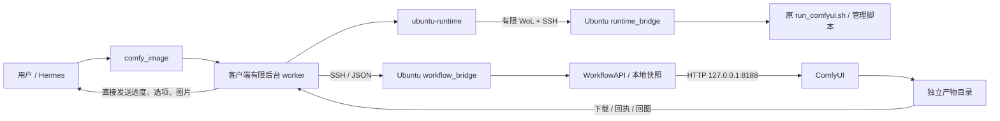

# MyHermes2Comfy

让 Hermes 通过 SSH 使用 Ubuntu 上的 ComfyUI：文生图、多图编辑、分辨率选择、异步回图，以及 Ubuntu 唤醒与 ComfyUI 生命周期管理。

代码分为两个可分别部署的包。它们共用版本契约，运行时均使用 Python 标准库；不安装或升级 ComfyUI、PyTorch、ROCm 与模型权重。

| 包 | 部署位置 | 内容 |
| --- | --- | --- |
| [hermes/](hermes/README.md) | 运行 Hermes 的电脑 | `comfy-workflows` 生图插件、`ubuntu-runtime` 管理插件、安装与契约导出脚本 |
| [ubuntu/](ubuntu/README.md) | ComfyUI 所在 Ubuntu | `comfy_workflow_api` SDK/CLI、工作流快照、SSH 服务端入口、进程管理、防休眠与数量清理 |



## Qwen Image 2.1 编辑的重要约束

**用生成图再次 edit 时，避免复用参考图生成时的 seed。** 当前 Qwen Image 2.1 配置的合成图交叉对照中，同源 seed 再编辑多次出现斑驳、硬边和纹理劣化；更换 seed 后未出现同类异常。这是当前工作流的已验证触发条件，不宣称所有模型都存在同样问题，也未据此确定底层机制。

Hermes 客户端的新旧编辑入口会查询当前 profile 的图片来源索引，自动避开全部参考图的已知直接生成 seed。客户端使用现有文件 SHA256 查询来源。改名和复制只要保留原始字节就能命中，重新保存后若哈希未登记则按未知来源处理。未知来源图允许编辑，省略 seed 时随机，显式 seed 未查到冲突时保留，并标记来源未校验。手动 ComfyUI 或直接使用 Ubuntu SDK/CLI 时，请自行选择新 seed。

## 当前行为

- 常用入口 `comfy_image`：提示词、`fast/quality`、可选参考图与尺寸；没有参考图就是文生图，支持 1–10 张有序 PNG 参考图。
- **fast**：LoRA 开启、6 步、Euler + Pruna 自定义 sigmas。**quality**：LoRA 关闭、25 步、Euler/simple；文生图和编辑一致，沿用当前 ComfyUI 模板配置。CFG 固定为 1，不提供负向提示词或任意步数。
- 客户端文生图默认 seed 固定为 **0**；edit 默认随机新 seed，并避开所有参考图的已知生成 seed。显式 seed 冲突也会自动替换，以 `seed_used` 和 `seed_policy` 告知实际值。`count=1..4` 保持连续递增 seed，整个区间都要通过校验。提示词最多 8000 字符，超限报错。
- 使用统一工作流，保持文生图/编辑别名兼容。切换 LoRA 会改变模型链，不能保证模型始终常驻或完全避免重新加载。
- 普通生图由后台流程准备服务，进度和图片直接回聊天；标题卡用于保留生成意图，不代表模型已经看过图片。保留旧的提交、任务查询接口用于诊断。
- HTTP 可应答仅表示接口存活；运行管理另有进程归属、挂起恢复检查与实际渲染验证。GPU 驱动故障仍可能需要人工处理，工具不自动重启主机。
- 可选安装 [Ubuntu 硬件监控与睡眠恢复](docs/hardware-monitor.md)：CPU/GPU 监控、SMTP 报警、睡眠前退出 ComfyUI、唤醒后按原状态恢复。有任务时阻止睡眠。
- 默认保留最近 100 个模块任务；只清理模块专用输入、输出命名空间，详情见 [Ubuntu 包说明](ubuntu/README.md)。

## 部署顺序

先部署 Ubuntu 包，再安装与配置 Hermes 插件。需要已有 ComfyUI、自定义节点、对应模型及原启动脚本；本仓库不下载模型或修改该环境。

1. 在 Ubuntu 保存完整 `ubuntu/` 目录，例如 `~/workspace/comfy-workflow-api`。进入目录执行 `uv sync --locked`，按 [Ubuntu 安装说明](ubuntu/README.md) 配置本地 ComfyUI 路径。`config/client-contract.json` 必须一起部署。
2. 在 Hermes 所在电脑进入本仓库，执行：

   ```bash
   uv sync --project hermes --locked
   uv run --project hermes python hermes/scripts/install.py --hermes-home "$HOME/.hermes"
   ```

   指定实际使用的 profile 目录。已有插件时，完成当前任务后加 `--replace`，脚本会备份两个旧插件，不修改配置或重启网关。
3. 将 [配置模板](hermes/config/config.example.yaml) 合并到该 profile 的 `config.yaml`，填写两个插件的 SSH 目标、私钥路径和 Ubuntu 包绝对路径。需要 WoL 时再填写 MAC、LAN 网段。模板地址只用于文档。
4. 在同一 profile 中启用 `comfy-workflows` 与 `ubuntu-runtime`，重新加载/重启 Hermes 网关，并按 [客户端验证说明](hermes/README.md) 检查工具注册与版本。已有网关使用其原管理方式。

当前 WoL 发送端使用 macOS 的路由/接口工具；其他系统可使用 SSH 调用已在线的 Ubuntu，唤醒部分需要另行适配。SSH 首次连接须先由操作者核对主机指纹，插件不会关闭主机校验。

## 使用示例

Hermes 工具参数示例，均通过 `comfy_image`：

```json
{"prompt":"A small geometric robot made of colorful wooden blocks, plain background", "preset":"fast", "size":"512x512", "seed":0, "title":"彩色积木机器人"}
```

```json
{"prompt":"以 <image1> 为编辑底图，保留机器人造型，参考 <image2> 的配色，改成蓝色和橙色", "images":["img_000001","img_000002"], "preset":"quality", "size":"auto", "title":"蓝橙机器人"}
```

两张以上参考图的 `<image1>`、`<image2>` 与数组顺序一致。图片 ID 来自当前会话的图像索引，也可使用 Hermes 主机上的 PNG 绝对路径。没有图片/只有一张图片时无需标签。

直接在 Ubuntu 使用 CLI，不经 Hermes：

```bash
cd ~/workspace/comfy-workflow-api
uv run comfy-workflow compile qwen-image-2.1-t2i --request examples/t2i.json
# 以下命令会提交真实生成任务：
uv run comfy-workflow run qwen-image-2.1-t2i --request examples/t2i.json
```

## 升级、验证与资料

两包应来自同一个提交。升级前结束正在执行的插件任务；替换 Ubuntu 源码、配置与快照，再 `uv sync --locked`；安装客户端后刷新网关。不要用新的默认配置覆盖现有实际配置。

客户端 hash 与服务端契约不一致时会出现 `stale_copy`，新提交应先修复版本漂移；不要反复提交试错。修改插件后导出并一起部署契约：

```bash
uv run --project hermes python hermes/scripts/export_contract.py --output ubuntu/config/client-contract.json
uv run --project ubuntu python scripts/check.py
```

根验证脚本会检查两个锁文件、全部离线测试、工作流快照、跨包版本/hash 和发布边界；不会连接真实 Ubuntu 或 ComfyUI。验证记录见 [发布验证报告](docs/validation.md)。

- [配置与部署边界](docs/configuration.md)
- [执行流程与数据流](docs/architecture.md)
- [故障排查](docs/troubleshooting.md)
- [开发与升级](docs/development.md)
- [来源与许可说明](NOTICE.md)

当前包版本：Ubuntu SDK / Hermes 包 **0.7.2**、生图插件 **0.6.5**、管理插件 **0.3.1**、契约 **7**。桌面自动回图需要支持持久完成通知及网关就绪回调的 Hermes 核心；工具参数保持兼容。
