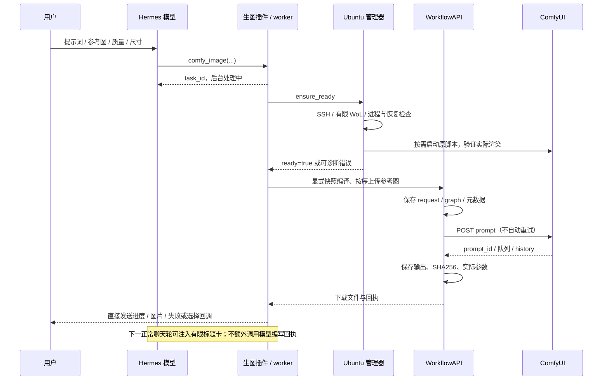

# 执行流程与数据流

## 两个包的边界

`hermes/` 的两个插件安装在同一 profile 的相邻插件目录。`comfy-workflows` 负责模型工具、会话内图片索引、任务回执、有限后台 worker、直接发送与标题卡；`ubuntu-runtime` 负责 LAN/WoL、SSH 与服务准备。它们不包含 ComfyUI 服务端实现。

`ubuntu/` 提供三个 SSH 服务入口：

| 模块 | 职责 |
| --- | --- |
| `comfy_workflow_api.workflow_bridge` | 校验 JSON 请求、提交/查询/下载任务、返回版本信息 |
| `comfy_workflow_api.runtime_bridge` | 实时状态探测、启动独立管理操作、查询操作回执 |
| `comfy_workflow_api.runtime_operation_worker` | 脱离 SSH 会话执行服务准备/停止/重启/恢复 |

Hermes 插件内的 `remote_bridge.py` 只是导入对应服务端 `main()` 的固定入口。远端必须事先部署完整 Ubuntu 包并建立 `.venv`，插件不上传第二套服务端源代码或自动修改 ComfyUI。

## 普通生图

服务准备有独立 `operation_id`；图像生成有本地插件 `task_id`、Ubuntu 模块任务 ID 与 ComfyUI `prompt_id`。这些 ID 的命名空间不同，不能互换。

上传、生成和下载记录分别留在各端任务目录。响应丢失时标记结果不确定，必须先查询原任务；不能以超时为由自动重提生成。

## 参数与快照

两种别名指向相同的当前工作流拓扑。编译器根据是否存在参考图移除未使用入口，根据 preset 切换 LoRA 和采样通路；保留已经验证的模型配置。quality 为 25 步 Euler/simple；fast 为 6 步 Euler/Pruna 自定义 sigmas；始终 CFG=1、负向为空。

快照显式同步，不跟随 UI 的临时更改。任务记录快照 hash、拓扑 hash、后端版本和客户端契约。快照默认提示词与图片名在分发时改为几何示例，执行时仍使用本次请求的参数。同步新拓扑后必须先校验支持范围，不应通过关闭校验硬跑。

## 状态、恢复与防休眠

- `ubuntu_status` 只读，不唤醒主机、不持有防休眠锁。离线无法仅凭网络区分睡眠、关机和网络故障。
- HTTP 存活、进程归属、最近挂起恢复与渲染验证是不同证据。`ready` 与本次服务实例/恢复周期关联，不能把旧回执的时间当成实时健康结果。
- 未知 GPU 利用率保持 `null`。`stalled=true` 是停滞嫌疑，不代表已经证明 GPU 故障。
- 停止前核对进程身份。正常活动队列受保护；针对受管故障实例的恢复可以自动按超时升级 SIGINT → SIGTERM → SIGKILL，并记录信号。没有旧版 `/comfy-recover` 人工确认环节，也不会误杀其他进程。
- 防休眠 lease 与调用者进程身份、模块请求及 ComfyUI 队列共同判断。不会单凭超时强放活跃任务锁；队列与请求均结束后按宽限期释放。SSH 状态查询不应为了查询而获取 lease。
- 生成、管理操作和 guard 都有各自 PID/启动标识/日志，脱离启动终端。它们不等同于新增系统服务或登录自启。

## 上下文与图片索引

`comfy_image` 可配置为常驻工具，管理和诊断工具保持可发现；是否常驻由兼容 Hermes 核心决定。`tool_history_echo` 是 Hermes 核心的历史投影设置，不由本仓库修改。

直接投递与按钮/命令回调避免把每条进度、选项或失败通知送入模型。标题卡保留有限的图片 ID、标题和任务信息，标题表示生成意图。真实图片是否满足意图，仍需要读图判断。产物过期后索引可以保留，但文件不能据此恢复。
