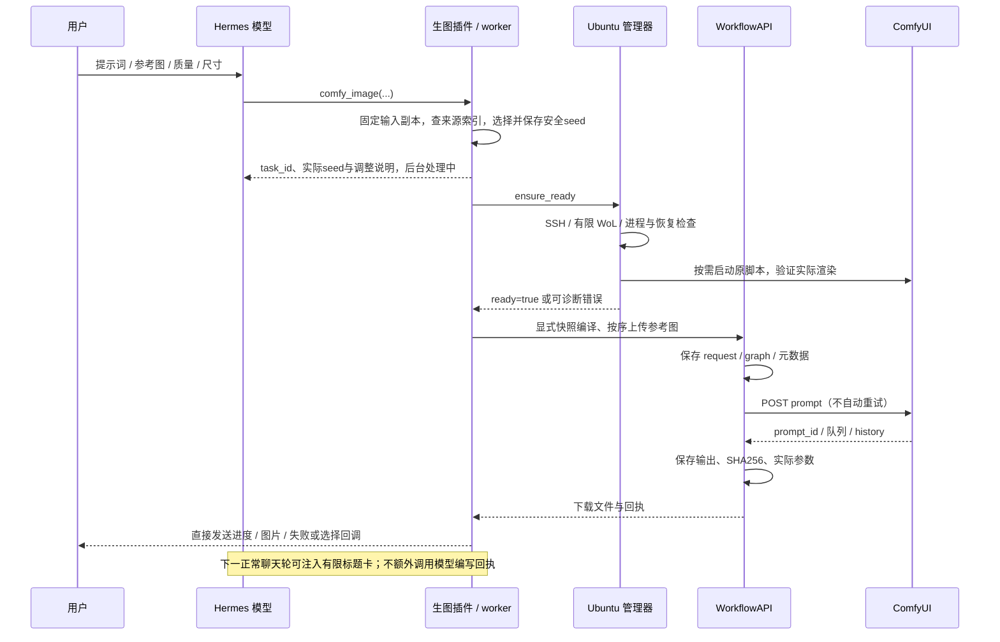

# 执行流程与数据流

## 两个包的边界

`hermes/` 的两个插件安装在同一 profile 的相邻插件目录。`comfy-workflows` 负责模型工具、会话内图片索引、任务回执、有限后台 worker、直接发送与标题卡；`ubuntu-runtime` 负责 LAN/WoL、SSH 与服务准备。它们不包含 ComfyUI 服务端实现。

`ubuntu/` 提供三个 SSH 服务入口：

| 模块 | 职责 |
| --- | --- |
| `comfy_workflow_api.workflow_bridge` | 校验 JSON 请求、提交/查询/下载任务、返回版本信息 |
| `comfy_workflow_api.runtime_bridge` | 实时状态探测、启动独立管理操作、查询操作回执 |
| `comfy_workflow_api.runtime_operation_worker` | 脱离 SSH 会话执行服务准备/停止/重启/恢复 |

Hermes 插件内的 `remote_bridge.py` 只是导入对应服务端 `main()` 的固定入口。远端必须事先部署完整 Ubuntu 包并建立 `.venv`，插件不上传第二套服务端源代码或自动修改 ComfyUI。

## 普通生图

服务准备有独立 `operation_id`；图像生成有本地插件 `task_id`、Ubuntu 模块任务 ID 与 ComfyUI `prompt_id`。这些 ID 的命名空间不同，不能互换。

上传、生成和下载记录分别留在各端任务目录。响应丢失时标记结果不确定，必须先查询原任务；不能以超时为由自动重提生成。

## 参数与快照

两种别名指向相同的当前工作流拓扑。编译器根据是否存在参考图移除未使用入口，根据 preset 切换 LoRA 和采样通路；保留已经验证的模型配置。quality 为 25 步 Euler/simple；fast 为 6 步 Euler/Pruna 自定义 sigmas；始终 CFG=1、负向为空。

编辑 `size=auto` 从客户端任务到后台 worker 始终保持 `follow_image`，由服务端编码器按第一张参考图处理后的尺寸提供采样 latent；fast 的 sigma 分辨率偏移也读取同一 latent。客户端不把原始 PNG 的宽高改写为显式输出尺寸。明确指定的比例或宽高使用独立尺寸分支。

快照显式同步，不跟随 UI 的临时更改。任务记录快照 hash、拓扑 hash、后端版本和客户端契约。快照默认提示词与图片名在分发时改为几何示例，执行时仍使用本次请求的参数。同步新拓扑后必须先校验支持范围，不应通过关闭校验硬跑。

## 编辑 seed 与来源索引

Qwen Image 2.1 生成图再次 edit 时避免复用其生成 seed。客户端统一与兼容编辑入口在上传/服务准备之前校验实际输入副本；worker 在尚未提交时复核输入校验和及约束。edit 默认随机，显式冲突自动换值并通过 `seed_used`、`seed_policy` 披露；文生图仍默认固定0。多图取全部参考图的已知直接生成 seed 并集，批量保持连续 `seed+i` 且整个区间避开并集。来源未知可以继续编辑，显式合法 seed 未查到冲突时保留并标记未知；数据库故障不降级为未知。

来源登记复用 `jobs.sqlite3`，记录全部 Qwen 文生图和编辑输出的文件 SHA256 与实际 seed。同一文件可对应多个 seed，uint64 seed 用十进制文本保存。输入的文件字节与已登记输出相同时即可匹配，重新保存后若哈希未登记则按未知来源处理。

下载校验后登记来源；首次升级从已有索引与旧回执幂等回填已记录的 SHA256 和 seed。回填不重新读取旧路径，文件过期或路径被新文件占用也不会改变原记录。此索引独立于图片、任务和回执的保留期限，不保存提示词与聊天正文。图片 ID 继续执行原会话授权，路径对应 hash 查询可在同 profile 内匹配，但不披露其他会话的身份或路径。

实际 seed 在首次远端提交前持久化，恢复不会重新随机；若尚未提交时发现新冲突，先保存新值并通知。已尝试提交的任务不得换 seed 或盲目重生。Ubuntu SDK/CLI 保留固定0默认，客户端保护不覆盖直接调用和手动 ComfyUI。

## 状态、恢复与防休眠

- `ubuntu_status` 只读，不唤醒主机、不持有防休眠锁。离线无法仅凭网络区分睡眠、关机和网络故障。
- HTTP 存活、进程归属、最近挂起恢复与渲染验证是不同证据。`ready` 与本次服务实例/恢复周期关联，不能把旧回执的时间当成实时健康结果。
- 未知 GPU 利用率保持 `null`。`stalled=true` 是停滞嫌疑，不代表已经证明 GPU 故障。
- 停止前核对进程身份。正常活动队列受保护；针对受管故障实例的恢复可以自动按超时升级 SIGINT → SIGTERM → SIGKILL，并记录信号。没有旧版 `/comfy-recover` 人工确认环节，也不会误杀其他进程。
- 防休眠 lease 与调用者进程身份、模块请求及 ComfyUI 队列共同判断。不会单凭超时强放活跃任务锁；队列与请求均结束后按宽限期释放。SSH 状态查询不应为了查询而获取 lease。
- 生成、管理操作和 guard 都有各自 PID/启动标识/日志，脱离启动终端。它们不等同于新增系统服务或登录自启。

## 上下文与图片索引

`comfy_image` 可配置为常驻工具，管理和诊断工具保持可发现；是否常驻由兼容 Hermes 核心决定。`tool_history_echo` 是 Hermes 核心的历史投影设置，不由本仓库修改。

直接投递与按钮/命令回调避免把每条进度、选项或失败通知送入模型。标题卡保留有限的图片 ID、标题和任务信息，标题表示生成意图。真实图片是否满足意图，仍需要读图判断。产物过期后索引可以保留，但文件不能据此恢复。

桌面任务在可信调用中取得核心签发的持久目标，worker 只写插件自己的任务与投递队列。独立本地消费者把冻结的事件提交给核心权威队列；核心验证 profile、原逻辑会话和附件，保留稳定副本，并将其保存为无需模型处理的完成通知。前端实时更新与历史回放使用同一条持久记录。

本地权限范围包含稳定路由 key 和逻辑会话 ID；历史压缩只更换物理存储 tip。任务创建后不会因切换窗口、临时断开或网关重启改换投递目标。原会话删除则取消后续投递；不会重建已删除会话。桌面使用原 target/event 身份幂等重放，Telegram 对不确定的原生发送仍要求显式补发。消费者在范围筛选后再限量读取，避免其他聊天的积压阻塞当前通知。
